# ELV & ICT Systems Convergence Overlay

## 1. Overview & Convergence Strategy

Modern enterprise buildings eliminate proprietary, siloed cabling networks by converging all **Extra Low Voltage (ELV)** and **Information & Communications Technology (ICT)** subsystems onto a unified, resilient IP/Ethernet structured backbone.

This document details how three critical ELV subsystems share the common physical switching infrastructure while maintaining strict logical isolation, Quality of Service (QoS), and Zero-Trust physical security:
1. **IP CCTV Surveillance (VLAN 70):** 32 high-definition IP cameras streaming continuous video to centralized Network Video Recorders (NVRs).
2. **Physical Access Control (VLAN 80):** 16 intelligent door controllers, biometric readers, and turnstiles managed by a central Access Control Server.
3. **VoIP IP Telephony (VLAN 40):** 200+ IP desk phones and SIP conference units managed by an on-premises IP PBX with SIP trunking.

---

## 2. ELV Infrastructure Convergence Overlay Diagram

```mermaid
flowchart TD
    subgraph HEADEND ["MDF: Ground Floor Server Room - Head-End Systems"]
        PBX["IP PBX Call Manager\n(IP: 10.10.20.15 - VLAN 20)"]
        NVR["CCTV NVR / VMS Storage\n(IP: 10.10.20.16 - VLAN 20 / 70)"]
        ACS["Access Control Server\n(IP: 10.10.20.17 - VLAN 20 / 80)"]
        CORE["Collapsed Core Switch Cluster\n(Catalyst 9500 Pair - L3 Routing & QoS PQ)"]
    end

    subgraph BACKBONE ["Vertical Riser Backbone (Structured OM4 MMF)"]
        RISER_GF["Ground Floor Uplink: 2x 10G OM4 MMF"]
        RISER_F1["Floor 1 Uplink: 2x 10G OM4 MMF"]
        RISER_F2["Floor 2 Uplink: 2x 10G OM4 MMF"]
        RISER_F3["Floor 3 Uplink: 2x 10G OM4 MMF"]
    end

    subgraph SW_LAYER ["Horizontal Access Switch Layer (PoE+ Catalyst 9300-48P)"]
        SW_GF["Acc-SW-GF (Ground Floor MDF)"]
        SW_F1["Acc-SW-F1 (Floor 1 IDF-1)"]
        SW_F2["Acc-SW-F2 (Floor 2 IDF-2)"]
        SW_F3["Acc-SW-F3 (Floor 3 IDF-3)"]
    end

    subgraph ELV_DEVICES_GF ["Ground Floor ELV Endpoints"]
        CAM_GF["8x IP Cameras (PoE 802.3af)\n[VLAN 70 - DSCP AF41]"]
        ACS_GF["4x Door Controllers (PoE 802.3af)\n[VLAN 80 - DSCP CS3]"]
        PH_GF["40x IP Desk Phones (PoE 802.3af)\n[VLAN 40 - DSCP EF]"]
        PC_GF["40x Workstations (Data Passthrough)\n[VLAN 30 - DSCP 0]"]
    end

    subgraph ELV_DEVICES_F1 ["Floor 1 ELV Endpoints"]
        CAM_F1["8x IP Cameras (PoE 802.3af)\n[VLAN 70 - DSCP AF41]"]
        ACS_F1["4x Door Controllers (PoE 802.3af)\n[VLAN 80 - DSCP CS3]"]
        PH_F1["60x IP Desk Phones (PoE 802.3af)\n[VLAN 40 - DSCP EF]"]
        PC_F1["60x Workstations (Data Passthrough)\n[VLAN 31 - DSCP 0]"]
    end

    subgraph ELV_DEVICES_F2 ["Floor 2 ELV Endpoints"]
        CAM_F2["8x IP Cameras (PoE 802.3af)\n[VLAN 70 - DSCP AF41]"]
        ACS_F2["4x Door Controllers (PoE 802.3af)\n[VLAN 80 - DSCP CS3]"]
        PH_F2["60x IP Desk Phones (PoE 802.3af)\n[VLAN 40 - DSCP EF]"]
        PC_F2["60x Workstations (Data Passthrough)\n[VLAN 32 - DSCP 0]"]
    end

    subgraph ELV_DEVICES_F3 ["Floor 3 ELV Endpoints"]
        CAM_F3["8x IP Cameras (PoE 802.3af)\n[VLAN 70 - DSCP AF41]"]
        ACS_F3["4x Door Controllers (PoE 802.3af)\n[VLAN 80 - DSCP CS3]"]
        PH_F3["40x IP Desk Phones (PoE 802.3af)\n[VLAN 40 - DSCP EF]"]
        PC_F3["40x Workstations (Data Passthrough)\n[VLAN 33 - DSCP 0]"]
    end

    %% Head-end to Core
    PBX ---|"10G DAC / Cat6A"| CORE
    NVR ---|"2x 10G SFP+ (Dual Homed)"| CORE
    ACS ---|"1G/10G Cat6A"| CORE

    %% Core to Riser
    CORE === RISER_GF === SW_GF
    CORE === RISER_F1 === SW_F1
    CORE === RISER_F2 === SW_F2
    CORE === RISER_F3 === SW_F3

    %% Switch to Ground Floor Endpoints
    SW_GF ---|"Cat6 PoE (802.3af) < 90m"| CAM_GF
    SW_GF ---|"Cat6 PoE (802.3af) < 90m"| ACS_GF
    SW_GF ---|"Cat6 PoE (802.3af) < 90m"| PH_GF
    PH_GF ---|"Cat6 Patch < 3m"| PC_GF

    %% Switch to Floor 1 Endpoints
    SW_F1 ---|"Cat6 PoE (802.3af) < 90m"| CAM_F1
    SW_F1 ---|"Cat6 PoE (802.3af) < 90m"| ACS_F1
    SW_F1 ---|"Cat6 PoE (802.3af) < 90m"| PH_F1
    PH_F1 ---|"Cat6 Patch < 3m"| PC_F1

    %% Switch to Floor 2 Endpoints
    SW_F2 ---|"Cat6 PoE (802.3af) < 90m"| CAM_F2
    SW_F2 ---|"Cat6 PoE (802.3af) < 90m"| ACS_F2
    SW_F2 ---|"Cat6 PoE (802.3af) < 90m"| PH_F2
    PH_F2 ---|"Cat6 Patch < 3m"| PC_F2

    %% Switch to Floor 3 Endpoints
    SW_F3 ---|"Cat6 PoE (802.3af) < 90m"| CAM_F3
    SW_F3 ---|"Cat6 PoE (802.3af) < 90m"| ACS_F3
    SW_F3 ---|"Cat6 PoE (802.3af) < 90m"| PH_F3
    PH_F3 ---|"Cat6 Patch < 3m"| PC_F3
```



---

## 3. Subsystem Technical Specifications & Bandwidth Requirements

| ELV Subsystem | Total Qty | Protocol / Transport | Bitrate per Device | Subnet Aggregate Bandwidth | Destination Head-End |
|---|:---:|---|:---:|:---:|---|
| **IP CCTV Cameras** | 32 | H.264 / H.265 RTSP unicast (1080p @ 25 fps) | 4–6 Mbps (avg 5 Mbps) | ~160 Mbps continuous stream | NVR Server (`10.10.20.16` / `10.10.70.5`) |
| **Access Control** | 16 | OSDP / Wiegand-over-IP, TLS TCP/IP | Burst (< 50 kbps) | < 2 Mbps peak burst | Access Control Server (`10.10.20.17`) |
| **VoIP Telephony** | 208 | G.711u / G.722 RTP Voice + SIP Signaling | 80–100 kbps per active call | ~10–20 Mbps concurrent calls | IP PBX (`10.10.20.15`) + Core SIP Trunk |
| **Wi-Fi 6 APs** | 12 | 802.11ax CAPWAP Tunnel / Local Bridging | Up to 1 Gbps peak burst | 1–3 Gbps campus aggregate | Core Switch / NGFW |

---

## 4. Power over Ethernet (PoE) Allocation & Power Budget

All ELV endpoints draw DC operating power directly from the access switchports over the horizontal Cat6 4-pair cabling, eliminating the need for dedicated 230V mains power outlets at camera, phone, or sensor locations.

### 4.1 IEEE PoE Standard Classifications

| Standard | IEEE Spec | Max Power at Switch Port | Max Power at Device (PD) | Typical Subsystems Deployed |
|---|---|:---:|:---:|---|
| **PoE (Type 1)** | IEEE 802.3af | **15.4 W** | **12.95 W** | Standard VoIP Phones, Fixed Dome CCTV Cameras, Single-Door Access Controllers |
| **PoE+ (Type 2)**| IEEE 802.3at | **30.0 W** | **25.5 W** | Wi-Fi 6 Access Points, PTZ Motorized Cameras, Biometric Turnstiles with Face Recognition |
| **PoE++ (Type 3)**| IEEE 802.3bt | **60.0 W** | **51.0 W** | High-draw outdoor PTZ with heaters/blowers, Smart AV Displays |

### 4.2 Floor-by-Floor PoE Power Budget Calculation

Each floor access switch stack utilizes dual redundant 715W AC power supplies, providing **740W of dedicated PoE power** per 48-port switch:

| Floor Location | Device Type | Device Qty | PoE Class / Standard | Power per Unit (W) | Total Power Draw (W) | Switch PoE Capacity | Headroom / Spare |
|---|---|:---:|:---:|:---:|:---:|:---:|:---:|
| **Ground Floor (MDF)**| Wi-Fi 6 APs | 3 | 802.3at (PoE+) | 20.0 W | 60.0 W | — | — |
| | CCTV Cameras | 8 | 802.3af (PoE) | 8.5 W | 68.0 W | — | — |
| | Access Controllers | 4 | 802.3af (PoE) | 10.0 W | 40.0 W | — | — |
| | IP Desk Phones | 40 | 802.3af (PoE) | 5.5 W | 220.0 W | — | — |
| | **GF Total** | **55** | — | — | **388.0 W** | **740 W (1x 48P)** | **47.6% (352W spare)** |
| **Floor 1 (IDF-1)** | Wi-Fi 6 APs | 3 | 802.3at (PoE+) | 20.0 W | 60.0 W | — | — |
| | CCTV Cameras | 8 | 802.3af (PoE) | 8.5 W | 68.0 W | — | — |
| | Access Controllers | 4 | 802.3af (PoE) | 10.0 W | 40.0 W | — | — |
| | IP Desk Phones | 60 | 802.3af (PoE) | 5.5 W | 330.0 W | — | — |
| | **Floor 1 Total** | **75** | — | — | **498.0 W** | **1480 W (2x 48P)**| **66.4% (982W spare)** |
| **Floor 2 (IDF-2)** | Wi-Fi 6 APs | 3 | 802.3at (PoE+) | 20.0 W | 60.0 W | — | — |
| | CCTV Cameras | 8 | 802.3af (PoE) | 8.5 W | 68.0 W | — | — |
| | Access Controllers | 4 | 802.3af (PoE) | 10.0 W | 40.0 W | — | — |
| | IP Desk Phones | 60 | 802.3af (PoE) | 5.5 W | 330.0 W | — | — |
| | **Floor 2 Total** | **75** | — | — | **498.0 W** | **1480 W (2x 48P)**| **66.4% (982W spare)** |
| **Floor 3 (IDF-3)** | Wi-Fi 6 APs | 3 | 802.3at (PoE+) | 20.0 W | 60.0 W | — | — |
| | CCTV Cameras | 8 | 802.3af (PoE) | 8.5 W | 68.0 W | — | — |
| | Access Controllers | 4 | 802.3af (PoE) | 10.0 W | 40.0 W | — | — |
| | IP Desk Phones | 40 | 802.3af (PoE) | 5.5 W | 220.0 W | — | — |
| | **Floor 3 Total** | **55** | — | — | **388.0 W** | **740 W (1x 48P)** | **47.6% (352W spare)** |
| **Building Aggregate**| **All Endpoints** | **260** | — | — | **1,772.0 W** | **4,440 W (Total)** | **60.1% Total Spare** |

---

## 5. Quality of Service (QoS) & Traffic Prioritization

Because delay-sensitive voice packets, bandwidth-intensive CCTV video streams, and bulk workstation data share the same physical 10G riser fiber links, a strict end-to-end Differentiated Services (DiffServ / RFC 4594) QoS model is configured:

```
┌────────────────────────────────────────────────────────────────────────┐
│ ACCESS SWITCH INGRESS (Catalyst 9300)                                   │
│  - Trust Phone markings (DSCP EF / CS3)                                │
│  - Mark CCTV Camera ingress to DSCP AF41 (Video)                       │
│  - Mark Access Control to DSCP CS3 (Signaling)                         │
│  - Remark untrusted PC traffic to DSCP 0 (Best Effort)                 │
└──────────────────────────────────┬─────────────────────────────────────┘
                                   │
                                   ▼
┌────────────────────────────────────────────────────────────────────────┐
│ QUEUING & SCHEDULING (Uplink Trunks & Core Switches)                  │
│  - Queue 1 (Priority Queue - Strict PQ): Voice Payload (DSCP EF)       │
│  - Queue 2 (Weighted Deficit Round Robin 30%): Video (DSCP AF41)       │
│  - Queue 3 (Weighted Deficit Round Robin 20%): ELV & Call Signaling    │
│  - Queue 4 (Weighted Deficit Round Robin 50%): Standard Data (DSCP 0)  │
└────────────────────────────────────────────────────────────────────────┘
```

### 5.1 QoS Classification and Marking Standards

| Subsystem / Traffic Type | 802.1p CoS | DSCP Name | DSCP Value | Egress Queue Policy | Drop Precedence / Buffer Behavior |
|---|:---:|:---:|:---:|:---:|---|
| **VoIP Voice Media (RTP)** | **5** | **EF** | 46 (`101110`) | **Queue 1: Strict Priority (PQ)** | Zero drop tolerance; immediate scheduling |
| **VoIP Call Signaling (SIP)**| **3** | **CS3** | 24 (`011000`) | Queue 3: Bandwidth Guaranteed | High priority control plane queue |
| **IP CCTV Video Feeds** | **4** | **AF41** | 34 (`100010`) | Queue 2: Weighted Deficit (WDRR 30%) | Low drop precedence; smoothed buffer |
| **Access Control Events** | **3** | **AF31** | 26 (`011010`) | Queue 3: Bandwidth Guaranteed | Time-critical physical security packets |
| **Network Management (SSH)**| **6** | **CS6** | 48 (`110000`) | Queue 3: Control Queue | Protected network operations |
| **Standard User Data** | **0** | **DF (Best Effort)**| 0 (`000000`) | Queue 4: Default Queue (WDRR 50%) | Weighted Fair Queueing / Tail Drop |

---

## 6. Zero-Trust Physical Security & ELV Isolation

Converging physical security systems onto the enterprise IP network introduces potential attack vectors (e.g., an attacker unplugging an outdoor camera to plug in a malicious laptop). This threat is completely mitigated by the following multi-layered controls:

1. **Strict 802.1Q Micro-Segmentation:**
   - CCTV cameras operate solely in **VLAN 70**.
   - Access controllers operate solely in **VLAN 80**.
   - Direct Layer 2 communication between ELV devices and user PCs is physically impossible.
2. **Layer 3 Access Control Lists (ACLs):**
   - Cameras cannot communicate with each other (private VLANs / protected switchports).
   - Cameras are denied all access to the Internet gateway and corporate user VLANs.
   - Only the NVR interface (`10.10.20.16` / `10.10.70.5`) is permitted to open RTSP sessions (TCP 554) to camera IP addresses.
3. **Cisco Port Security with Sticky MAC:**
   - Every camera and access controller switchport is locked to a single authorized MAC address:
     ```text
     switchport port-security maximum 1
     switchport port-security mac-address sticky
     switchport port-security violation shutdown
     ```
   - If an unauthorized laptop or rogue device is plugged into a camera cable drop, the switchport transitions immediately into the `err-disable` state, cutting link power and generating an instant SNMP / Syslog security alert to the network administrator.
4. **DHCP Snooping & Dynamic ARP Inspection (DAI):**
   - Protects ELV subnets from rogue DHCP servers and ARP poisoning attacks.

