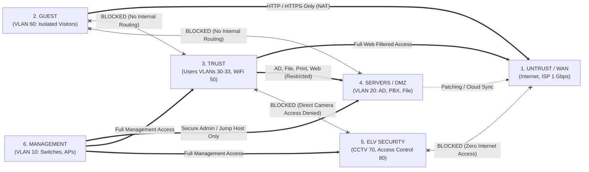

# Logical Layer 3 Network Topology & Routing Architecture

## 1. Overview & Layer 3 Routing Design

The enterprise network employs a **Hierarchical Layer 3 Routed Core** design. Inter-VLAN routing for high-bandwidth internal traffic is offloaded to the Collapsed Core switch pair, preventing the perimeter firewall from becoming a throughput bottleneck, while security inspection is enforced using:
1. **Firewall Zone Inspection:** Edge perimeter, external Internet access, Server DMZ, and untrusted Guest Wi-Fi traffic traverse the Next-Generation Firewall (NGFW).
2. **Core Switch SVI Access Control Lists (ACLs):** Enforce wire-speed packet filtering and micro-segmentation between internal VLANs directly on the Core Switch Switch Virtual Interfaces (SVIs).
3. **High Availability Gateways:** Cisco Hot Standby Router Protocol (HSRP) / Virtual Router Redundancy Protocol (VRRP) provides deterministic `.1` virtual IP gateways across dual Core switches.

---

## 2. Logical Layer 3 Topology Diagram

```mermaid
flowchart TD
    subgraph ZONE_WAN ["Firewall Zone: UNTRUST / WAN"]
        ISP_GW["Internet Gateway\nISP Public IP / BGP or Static\n0.0.0.0/0"]
    end

    subgraph NGFW_CLUSTER ["Perimeter Security Cluster (NGFW-01 / NGFW-02)"]
        FW_WAN["WAN Interface (eth1/1)\nPublic IP / Dynamic PAT"]
        FW_INSIDE["Inside Transit Interface (eth1/2)\nIP: 10.10.100.4 (VRRP VIP)"]
        FW_GUEST["Guest Gateway Interface (eth1/3)\nVLAN 60 SVI: 10.10.60.1/24"]
    end

    subgraph TRANSIT ["Layer 3 Transit Subnet (VLAN 100: 10.10.100.0/29)"]
        TRANSIT_NET["Transit Network: 10.10.100.0/29\nCore VIP: 10.10.100.1 (HSRP)\nNGFW VIP: 10.10.100.4 (VRRP)"]
    end

    subgraph CORE_L3 ["Collapsed Core L3 Routing Engine (Core-SW-01 & Core-SW-02)"]
        direction TB
        CORE_ROUTE["L3 IP Routing Engine\nDefault Route: 0.0.0.0/0 via 10.10.100.4\nOSPF Area 0 / Static Campus Summary 10.10.0.0/16"]

        subgraph SVI_MGMT ["Zone: MANAGEMENT"]
            SVI_10["VLAN 10 SVI: 10.10.10.1/24\nIn-Band Mgmt Gateway"]
        end

        subgraph SVI_SRV ["Zone: SERVERS / DMZ"]
            SVI_20["VLAN 20 SVI: 10.10.20.1/24\nProduction Server Gateway"]
        end

        subgraph SVI_USERS ["Zone: TRUST_USERS (Wired)"]
            SVI_30["VLAN 30 SVI: 10.10.30.1/24\nGround Floor Users"]
            SVI_31["VLAN 31 SVI: 10.10.31.1/24\nFloor 1 Users"]
            SVI_32["VLAN 32 SVI: 10.10.32.1/24\nFloor 2 Users"]
            SVI_33["VLAN 33 SVI: 10.10.33.1/24\nFloor 3 Users"]
        end

        subgraph SVI_VOICE ["Zone: VOICE_VOIP"]
            SVI_40["VLAN 40 SVI: 10.10.40.1/23\nIP Telephony Gateway"]
        end

        subgraph SVI_WIFI ["Zone: TRUST_WIFI"]
            SVI_50["VLAN 50 SVI: 10.10.50.1/23\nCorporate Wi-Fi Gateway"]
        end

        subgraph SVI_ELV ["Zone: ELV_SECURITY (Zero Internet)"]
            SVI_70["VLAN 70 SVI: 10.10.70.1/24\nIP CCTV Cameras Gateway"]
            SVI_80["VLAN 80 SVI: 10.10.80.1/24\nAccess Control Gateway"]
        end

        subgraph SVI_PRN ["Zone: PRINTERS"]
            SVI_90["VLAN 90 SVI: 10.10.90.1/24\nNetwork Printers Gateway"]
        end
    end

    subgraph ZONE_GUEST ["Firewall Zone: GUEST_ISOLATED"]
        GUEST_CLIENTS["VLAN 60: 10.10.60.0/24\nVisitor Laptops & Mobiles\nDirect Internet Only / No Internal Access"]
    end

    %% WAN routing
    ISP_GW <==|"1 Gbps OS2 Fiber (Public Subnet)"| FW_WAN

    %% Transit Connection
    FW_INSIDE <==|"2x 10G DAC / MMF (VLAN 100: 10.10.100.0/29)"| TRANSIT_NET
    TRANSIT_NET <==|"10G L3 Port-Channel (HSRP VIP 10.10.100.1)"| CORE_ROUTE

    %% Guest Isolation Direct to FW
    FW_GUEST <==|"1 Gbps / 10 Gbps 802.1Q Trunk (VLAN 60)"| GUEST_CLIENTS

    %% Core L3 Internal Interconnections
    CORE_ROUTE --- SVI_10
    CORE_ROUTE --- SVI_20
    CORE_ROUTE --- SVI_30
    CORE_ROUTE --- SVI_31
    CORE_ROUTE --- SVI_32
    CORE_ROUTE --- SVI_33
    CORE_ROUTE --- SVI_40
    CORE_ROUTE --- SVI_50
    CORE_ROUTE --- SVI_70
    CORE_ROUTE --- SVI_80
    CORE_ROUTE --- SVI_90
```

---

## 3. Layer 3 SVI & Gateway Configuration Matrix

| VLAN ID | Interface / SVI | Subnet & CIDR | HSRP Virtual IP (Default GW) | Core-SW-01 Physical IP | Core-SW-02 Physical IP | HSRP Priority (SW1 / SW2) | Security Zone | Helper Address (DHCP Relay) |
|:---:|---|---|:---:|:---:|:---:|:---:|---|---|
| **10** | `Vlan10` | `10.10.10.0/24` | `10.10.10.1` | `10.10.10.2` | `10.10.10.3` | 110 / 100 | `ZONE_MGMT` | None (Static) / `10.10.20.10` |
| **20** | `Vlan20` | `10.10.20.0/24` | `10.10.20.1` | `10.10.20.2` | `10.10.20.3` | 110 / 100 | `ZONE_SERVERS` | None (Static allocations) |
| **30** | `Vlan30` | `10.10.30.0/24` | `10.10.30.1` | `10.10.30.2` | `10.10.30.3` | 110 / 100 | `ZONE_TRUST_GF` | `10.10.20.10`, `10.10.20.11` |
| **31** | `Vlan31` | `10.10.31.0/24` | `10.10.31.1` | `10.10.31.2` | `10.10.31.3` | 110 / 100 | `ZONE_TRUST_F1` | `10.10.20.10`, `10.10.20.11` |
| **32** | `Vlan32` | `10.10.32.0/24` | `10.10.32.1` | `10.10.32.2` | `10.10.32.3` | 110 / 100 | `ZONE_TRUST_F2` | `10.10.20.10`, `10.10.20.11` |
| **33** | `Vlan33` | `10.10.33.0/24` | `10.10.33.1` | `10.10.33.2` | `10.10.33.3` | 110 / 100 | `ZONE_TRUST_F3` | `10.10.20.10`, `10.10.20.11` |
| **40** | `Vlan40` | `10.10.40.0/23` | `10.10.40.1` | `10.10.40.2` | `10.10.40.3` | 110 / 100 | `ZONE_VOICE` | `10.10.20.10`, `10.10.20.11` |
| **50** | `Vlan50` | `10.10.50.0/23` | `10.10.50.1` | `10.10.50.2` | `10.10.50.3` | 110 / 100 | `ZONE_TRUST_WIFI`| `10.10.20.10`, `10.10.20.11` |
| **60** | `Vlan60` | `10.10.60.0/24` | `10.10.60.1` *(on FW)* | *N/A (L2 on Core)*| *N/A (L2 on Core)*| *N/A (Active/Pass FW)*| `ZONE_GUEST` | Direct on NGFW (`10.10.60.1`) |
| **70** | `Vlan70` | `10.10.70.0/24` | `10.10.70.1` | `10.10.70.2` | `10.10.70.3` | 110 / 100 | `ZONE_ELV_CCTV` | None (Static) / Staging pool |
| **80** | `Vlan80` | `10.10.80.0/24` | `10.10.80.1` | `10.10.80.2` | `10.10.80.3` | 110 / 100 | `ZONE_ELV_ACCESS`| None (Static) / Staging pool |
| **90** | `Vlan90` | `10.10.90.0/24` | `10.10.90.1` | `10.10.90.2` | `10.10.90.3` | 110 / 100 | `ZONE_PRINTERS` | `10.10.20.10`, `10.10.20.11` |
| **100**| `Vlan100`| `10.10.100.0/29`| `10.10.100.1` | `10.10.100.2` | `10.10.100.3` | 110 / 100 | `ZONE_TRANSIT` | *N/A (L3 Transit to NGFW)* |

---

## 4. Routing Table Architecture & Default Gateway Flow

### 4.1 Upstream Routing Path (Client to Internet)
1. **User Client Gateway:** Host on Floor 1 (`10.10.31.105`) sends outbound web traffic to its default gateway `10.10.31.1` (Core Switch HSRP VIP).
2. **Core Switch Route Lookup:** The Core Switch looks up its routing table:
   ```text
   Core-SW# show ip route
   Gateway of last resort is 10.10.100.4 to network 0.0.0.0
   S*   0.0.0.0/0 [1/0] via 10.10.100.4 (NGFW Inside VIP)
   ```
3. **Firewall Security Inspection:** The packet arrives on the firewall inside transit interface (`10.10.100.4`). The NGFW:
   - Identifies source zone (`ZONE_TRUST_USERS`) and destination zone (`ZONE_WAN`).
   - Evaluates security policies (Antivirus, IPS, SSL decryption, Web Filter).
   - Applies Dynamic Port Address Translation (PAT) rewriting source IP to the ISP Public IP.
   - Forwards traffic out `eth1/1` to the ISP Gateway.

### 4.2 Downstream Return Path (Internet to Client)
1. Inbound return packet from web server arrives at NGFW WAN interface.
2. The firewall evaluates the stateful translation session table, unwraps NAT, and performs routing lookup:
   ```text
   NGFW# get router info routing-table all
   S    10.10.0.0/16 [10/0] via 10.10.100.1 (Core Switch HSRP VIP)
   ```
3. The firewall forwards the packet across the transit VLAN 100 to `10.10.100.1`.
4. The Core Switch forwards the packet directly to the local ARP table entry on `Vlan31` down to Floor 1.

---

## 5. Security Zone Architecture & Inter-Zone Rules

The Next-Generation Firewall establishes six primary security zones:



### Security Policy Rules:
1. **Guest Isolation (Rule 100):** `ZONE_GUEST` $\to$ `ZONE_WAN` is permitted for DNS (UDP 53) and HTTP/HTTPS (TCP 80/443). All traffic from `ZONE_GUEST` to any internal corporate zone (`ZONE_TRUST`, `ZONE_SERVERS`, `ZONE_ELV`, `ZONE_MGMT`) is dropped with an explicit log action.
2. **ELV Containment (Rule 200):** `ZONE_ELV` has **no default route to the Internet**. Cameras and door controllers cannot initiate connections outbound to the WAN or to user subnets. Only authorized VMS/NVR recording interfaces in `ZONE_SERVERS` can pull RTSP video streams from `VLAN 70`.
3. **Management Jump Box (Rule 300):** Access to `ZONE_MGMT` (SSH, HTTPS, SNMP) is restricted strictly to designated IT Admin subnets and authenticated jump hosts via multi-factor authentication (MFA).

