# Physical Network Topology

## 1. Overview & Physical Infrastructure Architecture

The enterprise network physical topology is organized around a **Collapsed Core-Distribution** architecture located in the Main Distribution Frame (MDF / Server Room) on the Ground Floor, servicing three Intermediate Distribution Frames (IDFs) on Floors 1, 2, and 3 via a structured vertical riser backbone.

### Design Highlights:
- **Perimeter Edge:** 1 Gbps single-mode fiber handoff from the Service Provider terminates on an ISP Network Termination Unit (NTU) and connects to a High-Availability Next-Generation Firewall (NGFW) cluster.
- **Collapsed Core Layer:** Dual redundant Cisco Catalyst 9500-24Y4C 10/25G switches deployed as an active/standby or multi-chassis EtherChannel (MEC/StackWise-Virtual) cluster in the MDF.
- **Riser Backbone:** Dual OM4 multimode fiber runs from the MDF to each floor IDF, bonded into 20 Gbps (2 $\times$ 10G) LACP Link Aggregation Groups (LAGs / Port-Channels).
- **Horizontal Access Layer:** Stackable Cisco Catalyst 9300-48P PoE+ switches on each floor supplying 1 Gbps Ethernet with IEEE 802.3af/at PoE to workstations, IP phones, Wi-Fi 6 APs, CCTV cameras, access controllers, and printers over Cat6 copper cabling (max 90 m permanent link).

---

## 2. Complete Physical Topology Diagram

```mermaid
flowchart TD
    subgraph WAN ["Perimeter / Internet Demarcation"]
        ISP["ISP Fiber NTU / Hand-off\n(1 Gbps Metro-Ethernet)"]
    end

    subgraph MDF_SEC ["MDF: Ground Floor Server Room - Security Rack"]
        FW1["NGFW-01 (Primary Node)\nFortiGate / Palo Alto"]
        FW2["NGFW-02 (Secondary Node)\nFortiGate / Palo Alto"]
    end

    subgraph MDF_CORE ["MDF: Ground Floor Server Room - Core Rack"]
        CORE1["Core-SW-01 (Catalyst 9500)\nMaster / L3 Gateway"]
        CORE2["Core-SW-02 (Catalyst 9500)\nStandby / L3 Gateway"]
        WLC["Hardware WLC Cluster\n(Catalyst 9800-L)"]
        SRV["Server Farm & Storage\n(ESXi Hosts, NVR, PBX, AD DC)"]
    end

    subgraph IDF_GF ["MDF / IDF-0: Ground Floor Access"]
        ACC_GF["Acc-SW-GF Stack (Catalyst 9300-48P)\nGround Floor Access"]
        GF_AP["3x Wi-Fi 6 APs\n(Ground Floor)"]
        GF_CAM["8x IP CCTV Cameras\n(Ground Floor)"]
        GF_ACS["4x Access Controllers\n(Ground Floor Doors)"]
        GF_PH["40x IP Phones\n(Ground Floor)"]
        GF_PC["40x User Workstations\n(Ground Floor)"]
        GF_PRN["2x Network MFPs\n(Ground Floor)"]
    end

    subgraph IDF_1 ["IDF-1: Floor 1 Comms Cabinet"]
        ACC_F1["Acc-SW-F1 Stack (Catalyst 9300-48P)\nFloor 1 Access"]
        F1_AP["3x Wi-Fi 6 APs\n(Floor 1)"]
        F1_CAM["8x IP CCTV Cameras\n(Floor 1)"]
        F1_ACS["4x Access Controllers\n(Floor 1 Doors)"]
        F1_PH["60x IP Phones\n(Floor 1)"]
        F1_PC["60x User Workstations\n(Floor 1)"]
        F1_PRN["2x Network MFPs\n(Floor 1)"]
    end

    subgraph IDF_2 ["IDF-2: Floor 2 Comms Cabinet"]
        ACC_F2["Acc-SW-F2 Stack (Catalyst 9300-48P)\nFloor 2 Access"]
        F2_AP["3x Wi-Fi 6 APs\n(Floor 2)"]
        F2_CAM["8x IP CCTV Cameras\n(Floor 2)"]
        F2_ACS["4x Access Controllers\n(Floor 2 Doors)"]
        F2_PH["60x IP Phones\n(Floor 2)"]
        F2_PC["60x User Workstations\n(Floor 2)"]
        F2_PRN["2x Network MFPs\n(Floor 2)"]
    end

    subgraph IDF_3 ["IDF-3: Floor 3 Comms Cabinet"]
        ACC_F3["Acc-SW-F3 Stack (Catalyst 9300-48P)\nFloor 3 Access"]
        F3_AP["3x Wi-Fi 6 APs\n(Floor 3)"]
        F3_CAM["8x IP CCTV Cameras\n(Floor 3)"]
        F3_ACS["4x Access Controllers\n(Floor 3 Doors)"]
        F3_PH["40x IP Phones\n(Floor 3)"]
        F3_PC["40x User Workstations\n(Floor 3)"]
        F3_PRN["2x Network MFPs\n(Floor 3)"]
    end

    %% WAN Links
    ISP -->|"1 Gbps OS2 SMF (LC-Duplex)"| FW1
    ISP -.->|"1 Gbps OS2 SMF (Redundant Standby)"| FW2

    %% Firewall HA Heartbeat & Sync
    FW1 <-->|"2x 1 Gbps Cat6 Direct (HA Heartbeat / Sync)"| FW2

    %% Firewall to Core Uplinks
    FW1 -->|"10 Gbps SFP+ Direct Attach Copper (DAC)"| CORE1
    FW1 -->|"10 Gbps SFP+ Direct Attach Copper (DAC)"| CORE2
    FW2 -->|"10 Gbps SFP+ Direct Attach Copper (DAC)"| CORE1
    FW2 -->|"10 Gbps SFP+ Direct Attach Copper (DAC)"| CORE2

    %% Core Interconnect
    CORE1 <-->|"2x 25 Gbps / 40 Gbps StackWise / LACP (Po10)"| CORE2

    %% Core to Management & Servers
    CORE1 -->|"2x 10 Gbps SFP+ (LACP Po20)"| SRV
    CORE2 -->|"2x 10 Gbps SFP+ (LACP Po20)"| SRV
    CORE1 -->|"2x 1 Gbps Cat6 (LACP Po30)"| WLC
    CORE2 -->|"2x 1 Gbps Cat6 (LACP Po30)"| WLC

    %% Riser Backbone Uplinks to Access Switches
    CORE1 ===|"10 Gbps OM4 MMF (LC-LC) Uplink 1"| ACC_GF
    CORE2 ===|"10 Gbps OM4 MMF (LC-LC) Uplink 2"| ACC_GF
    CORE1 ===|"10 Gbps OM4 MMF (LC-LC) Uplink 1"| ACC_F1
    CORE2 ===|"10 Gbps OM4 MMF (LC-LC) Uplink 2"| ACC_F1
    CORE1 ===|"10 Gbps OM4 MMF (LC-LC) Uplink 1"| ACC_F2
    CORE2 ===|"10 Gbps OM4 MMF (LC-LC) Uplink 2"| ACC_F2
    CORE1 ===|"10 Gbps OM4 MMF (LC-LC) Uplink 1"| ACC_F3
    CORE2 ===|"10 Gbps OM4 MMF (LC-LC) Uplink 2"| ACC_F3

    %% Horizontal Access - Ground Floor
    ACC_GF ---|"1 Gbps Cat6 PoE+ (802.3at)"| GF_AP
    ACC_GF ---|"100/1000M Cat6 PoE (802.3af)"| GF_CAM
    ACC_GF ---|"100M Cat6 PoE (802.3af)"| GF_ACS
    ACC_GF ---|"1 Gbps Cat6 PoE (802.3af)"| GF_PH
    GF_PH ---|"1 Gbps Cat6 Passthrough"| GF_PC
    ACC_GF ---|"1 Gbps Cat6 UTP"| GF_PRN

    %% Horizontal Access - Floor 1
    ACC_F1 ---|"1 Gbps Cat6 PoE+ (802.3at)"| F1_AP
    ACC_F1 ---|"100/1000M Cat6 PoE (802.3af)"| F1_CAM
    ACC_F1 ---|"100M Cat6 PoE (802.3af)"| F1_ACS
    ACC_F1 ---|"1 Gbps Cat6 PoE (802.3af)"| F1_PH
    F1_PH ---|"1 Gbps Cat6 Passthrough"| F1_PC
    ACC_F1 ---|"1 Gbps Cat6 UTP"| F1_PRN

    %% Horizontal Access - Floor 2
    ACC_F2 ---|"1 Gbps Cat6 PoE+ (802.3at)"| F2_AP
    ACC_F2 ---|"100/1000M Cat6 PoE (802.3af)"| F2_CAM
    ACC_F2 ---|"100M Cat6 PoE (802.3af)"| F2_ACS
    ACC_F2 ---|"1 Gbps Cat6 PoE (802.3af)"| F2_PH
    F2_PH ---|"1 Gbps Cat6 Passthrough"| F2_PC
    ACC_F2 ---|"1 Gbps Cat6 UTP"| F2_PRN

    %% Horizontal Access - Floor 3
    ACC_F3 ---|"1 Gbps Cat6 PoE+ (802.3at)"| F3_AP
    ACC_F3 ---|"100/1000M Cat6 PoE (802.3af)"| F3_CAM
    ACC_F3 ---|"100M Cat6 PoE (802.3af)"| F3_ACS
    ACC_F3 ---|"1 Gbps Cat6 PoE (802.3af)"| F3_PH
    F3_PH ---|"1 Gbps Cat6 Passthrough"| F3_PC
    ACC_F3 ---|"1 Gbps Cat6 UTP"| F3_PRN
```



---

## 3. Physical Media, Transceivers & Link Speeds Specification

| Link Segment | End A | End B | Cable Medium | Transceiver / Interface Type | Nominal Speed | Protocol / LAG | Max Distance |
|---|---|---|---|---|:---:|:---:|:---:|
| **WAN Primary** | ISP NTU Port 1 | NGFW-01 `eth1/1` | Single-Mode Fiber (OS2) | 1000BASE-LX SFP (1310 nm LC duplex) | 1 Gbps | Routed Point-to-Point | Up to 10 km |
| **WAN Redundant**| ISP NTU Port 2 | NGFW-02 `eth1/1` | Single-Mode Fiber (OS2) | 1000BASE-LX SFP (1310 nm LC duplex) | 1 Gbps | Active/Passive Standby | Up to 10 km |
| **Firewall HA Sync**| NGFW-01 `ha1/ha2`| NGFW-02 `ha1/ha2`| Cat6 Shielded (F/UTP) | 1000BASE-T RJ45 Copper | 2 $\times$ 1 Gbps | Proprietary HA Heartbeat | < 3 m (In-rack) |
| **Firewall to Core**| NGFW-01 / 02 | Core-SW-01 / 02 | Passive SFP+ Twinax | SFP+ Direct Attach Copper (DAC) | 4 $\times$ 10 Gbps | L3 Transit Subnet (VLAN 100) | < 3 m (In-rack) |
| **Core Interconnect**| Core-SW-01 | Core-SW-02 | QSFP28 Direct Attach / MMF | 2 $\times$ 25G / 40G DAC or StackWise-V | 50–80 Gbps | StackWise-Virtual / LACP Po10 | < 3 m (In-rack) |
| **Riser to GF Access**| Core Pair | Acc-SW-GF Stack | OM4 Multimode Fiber | 10GBASE-SR SFP+ (850 nm LC duplex) | 2 $\times$ 10 Gbps | 20 Gbps LACP EtherChannel (Po1) | < 15 m |
| **Riser to F1 Access**| Core Pair | Acc-SW-F1 Stack | OM4 Multimode Fiber | 10GBASE-SR SFP+ (850 nm LC duplex) | 2 $\times$ 10 Gbps | 20 Gbps LACP EtherChannel (Po2) | < 35 m |
| **Riser to F2 Access**| Core Pair | Acc-SW-F2 Stack | OM4 Multimode Fiber | 10GBASE-SR SFP+ (850 nm LC duplex) | 2 $\times$ 10 Gbps | 20 Gbps LACP EtherChannel (Po3) | < 50 m |
| **Riser to F3 Access**| Core Pair | Acc-SW-F3 Stack | OM4 Multimode Fiber | 10GBASE-SR SFP+ (850 nm LC duplex) | 2 $\times$ 10 Gbps | 20 Gbps LACP EtherChannel (Po4) | < 65 m |
| **Core to Servers** | Core Pair | Server ESXi / SAN | SFP+ Twinax / Cat6A | 10GBASE-CU DAC or 10GBASE-T | 2 $\times$ 10 Gbps | LACP 802.3ad Bond | < 5 m (In-rack) |
| **Horizontal APs** | Floor Switches | Wi-Fi 6 APs | Cat6 UTP Solid | 1000BASE-T / 2.5G Multi-Gig RJ45 | 1–2.5 Gbps | PoE+ (802.3at up to 30W) | < 80 m |
| **Horizontal Phones**| Floor Switches | Cisco / Yealink Phones| Cat6 UTP Solid | 1000BASE-T RJ45 Copper | 1 Gbps | PoE (802.3af up to 15.4W) | < 90 m |
| **Horizontal Workstations**| IP Phone PC Port | User Workstation / Dock| Cat6 Patch Cord | 1000BASE-T RJ45 Copper | 1 Gbps | Untagged Data VLAN | < 3 m desk patch |
| **Horizontal CCTV** | Floor Switches | IP Dome/Bullet Cameras| Cat6 UTP Solid | 100BASE-TX / 1000BASE-T RJ45 | 100M/1 Gbps | PoE (802.3af / 802.3at) | < 90 m |
| **Access Control** | Floor Switches | Door Access Controllers | Cat6 UTP Solid | 100BASE-TX RJ45 Copper | 100 Mbps | PoE (802.3af up to 15.4W) | < 90 m |
| **Network Printers** | Floor Switches | Network MFPs | Cat6 UTP Solid | 1000BASE-T RJ45 Copper | 1 Gbps | Dedicated Access Port | < 70 m |

---

## 4. Structured Riser Backbone Architecture

The building features a dedicated vertical telecommunications riser shaft running continuously from the Ground Floor MDF to the Third Floor IDF.

```
 [ROOF]
   │
 ┌─┴───────────────────────────────────────────────────────┐
 │ FLOOR 3 - IDF-3 (Wall Rack 18U)                         │
 │ - Acc-SW-F3 (48P PoE+)                                  │
 │ - Fiber Patch Panel (12-port LC OM4)                    │
 └─┬───────────────────────────────────────────────────────┘
   │ 12-Core OM4 MMF Riser Cable (Tight-Buffered LSZH)
 ┌─┴───────────────────────────────────────────────────────┐
 │ FLOOR 2 - IDF-2 (Wall Rack 18U)                         │
 │ - Acc-SW-F2 (2x 48P PoE+ Stacked)                       │
 │ - Fiber Patch Panel (12-port LC OM4)                    │
 └─┬───────────────────────────────────────────────────────┘
   │ 12-Core OM4 MMF Riser Cable (Tight-Buffered LSZH)
 ┌─┴───────────────────────────────────────────────────────┐
 │ FLOOR 1 - IDF-1 (Wall Rack 18U)                         │
 │ - Acc-SW-F1 (2x 48P PoE+ Stacked)                       │
 │ - Fiber Patch Panel (12-port LC OM4)                    │
 └─┬───────────────────────────────────────────────────────┘
   │ 24-Core OM4 MMF Riser Backbone Cable
 ┌─┴───────────────────────────────────────────────────────┐
 │ GROUND FLOOR - MDF / SERVER ROOM (2x 42U Server Racks)  │
 │ - Core-SW-01 & Core-SW-02 (Catalyst 9500)               │
 │ - Acc-SW-GF (48P PoE+)                                  │
 │ - NGFW-01 & NGFW-02 High Availability Cluster           │
 │ - Main Optical Distribution Frame (ODF)                 │
 └─────────────────────────────────────────────────────────┘
```

### Cabling Best-Practice Rules Implemented:
1. **Diverse Fiber Routing:** Dual fiber runs between MDF and each IDF utilize separate conduit pathways in the riser shaft to protect against accidental physical severance.
2. **Permanent Link Rule:** All horizontal Cat6 copper runs terminate at RJ45 patch panels in the IDF/MDF and faceplates at the user end, adhering to the ANSI/TIA-568 standard:
   $$\text{Permanent Link} \le 90\,\text{m}, \quad \text{Patch Cords} \le 10\,\text{m (combined)}, \quad \text{Total Channel} \le 100\,\text{m}$$
3. **Low Smoke Zero Halogen (LSZH):** All riser and horizontal cables comply with IEC 60332-1 LSZH fire safety regulations for enclosed commercial office spaces.

---

## 5. Physical Cable Color Coding Standards

To ensure rapid troubleshooting and prevent accidental patching mistakes, the structured cabling installation strictly enforces the following color code:

| Cable Color | Designated Subsystem | Typical Devices |
|:---:|---|---|
| 🔵 **Blue** | Standard User Data | Workstations, Laptops, Docking Stations |
| 🟡 **Yellow** | IP Telephony / Voice | VoIP Desk Phones, SIP Conference Units |
| 🟣 **Purple** | Wireless Access Points | Ceiling-mounted Wi-Fi 6 APs |
| 🔴 **Red** | Physical Security & ELV | IP CCTV Cameras, NVR streaming links |
| 🟠 **Orange** | Access Control & Intercom | Door controllers, Biometric readers, Maglocks |
| 🟢 **Green** | Network Printers & Copiers | Network MFPs, Plotters |
| ⚫ **Black / Grey**| Network Infrastructure | Switch-to-switch patch cords, Server links |
| 💧 **Aqua (OM4)** | Optical Fiber Riser | MDF-to-IDF multi-mode 10G/25G uplinks |
| 🟡 **Yellow (OS2)**| Optical Fiber WAN | ISP single-mode 1 Gbps Metro-E drop |

