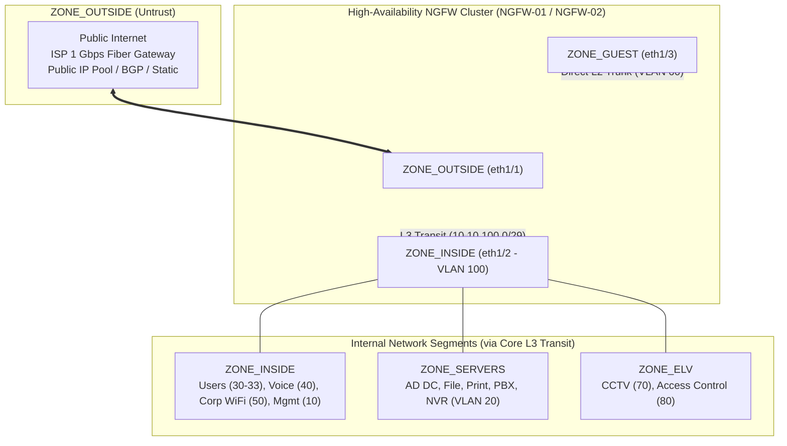

# Perimeter Firewall, NAT & Access Control Architecture

## 1. Overview & Security Strategy

The enterprise perimeter security architecture utilizes a High-Availability (HA) Next-Generation Firewall (NGFW) cluster deployed in an active/passive configuration at the network edge. 

The firewall acts as the security boundary between:
1. The untrusted Public Internet (WAN).
2. The isolated Visitor Guest Wi-Fi network (`VLAN 60`).
3. The internal Enterprise Corporate Network (routed across Layer 3 Transit `VLAN 100`).

To ensure optimal performance and eliminate throughput bottlenecks, high-speed internal inter-VLAN routing is handled by the Collapsed Core switches at wire-speed, while the perimeter firewall inspects all north-south Internet-bound traffic, remote-access VPN tunnels, and external DMZ publishing.

---

## 2. Firewall Security Zones

The firewall groups interfaces and subnets into five deterministic security zones:



### Security Zones Definition:

| Security Zone Name | Interfaces / Subnets Included | Security Level | Primary Purpose & Access Restrictions |
|---|---|:---:|---|
| **`ZONE_OUTSIDE`** | `eth1/1` (Public WAN Handoff) | **0 (Untrusted)** | Public Internet handoff. Default-deny on all unsolicited inbound connections. Stateful inspection, IPS, anti-malware, and geo-blocking active. |
| **`ZONE_GUEST`** | `eth1/3` (`10.10.60.0/24` - VLAN 60) | **10 (Isolated)** | Direct physical/sub-interface termination from Core switch. Access restricted exclusively to outbound HTTP/HTTPS/DNS. Complete block to all internal zones. |
| **`ZONE_ELV`** | Via Transit (`10.10.70.0/24`, `10.10.80.0/24`) | **30 (Restricted)** | CCTV cameras and physical access controllers. **Zero Internet Access.** Restricted strictly to head-end NVR and ACS server interfaces in DMZ. |
| **`ZONE_INSIDE`** | Via Transit (VLANs 10, 30–33, 40, 50, 90) | **70 (Trusted)** | Corporate wired workstations, Wi-Fi laptops, IP phones, printers, and management infrastructure. Full outbound web inspection with Content Filtering. |
| **`ZONE_SERVERS`** | Via Transit (`10.10.20.0/24` - VLAN 20) | **90 (High Trust)** | Active Directory, DNS/DHCP, VoIP PBX, File/Storage, and NVR servers. Outbound connections restricted to authorized OS patch repositories and SIP trunks. |

---

## 3. Zone-to-Zone Policy Matrix

Traffic traversing security boundaries is evaluated against an explicit least-privilege matrix:

| Source Zone | Destination Zone | Permitted Services / Protocols | Action | Business Justification |
|---|---|---|:---:|---|
| **`ZONE_INSIDE`** | `ZONE_OUTSIDE` | HTTP (80), HTTPS (443), DNS (53), NTP (123) | **ALLOW** | Corporate employee web browsing, cloud SaaS (Microsoft 365, Google Workspace), and external collaboration. Inspected by IPS, Antivirus, and SSL Decryption. |
| **`ZONE_GUEST`** | `ZONE_OUTSIDE` | HTTP (80), HTTPS (443), DNS (UDP 53) | **ALLOW** | Internet-only access for visitors and contractors. Bandwidth capped at 10 Mbps per client with captive portal authentication. |
| **`ZONE_GUEST`** | `ZONE_INSIDE` / `SERVERS` / `ELV` | Any | **DENY** | **Strict Air-Gap Isolation.** Protects enterprise internal resources from untrusted visitor devices. |
| **`ZONE_SERVERS`** | `ZONE_OUTSIDE` | HTTPS (443), NTP (123), SIP (5060), RTP (UDP 10000–20000) | **ALLOW** | Windows Update, Antivirus signature updates, Off-site encrypted backup replication, and VoIP external SIP trunking to ITSP. |
| **`ZONE_ELV`** | `ZONE_OUTSIDE` | Any | **DENY** | **Zero-Trust IoT Containment.** CCTV cameras and door controllers have no default route or internet access, preventing firmware hijacking or botnet recruiting. |
| **`ZONE_OUTSIDE`** | `ZONE_SERVERS` | HTTPS (TCP 443 via Reverse Proxy / WAF) | **ALLOW** | External employee access to published corporate portal / web services. Inspected by Web Application Firewall (WAF) profiles. |
| **`ZONE_OUTSIDE`** | `ZONE_INSIDE` / `ZONE_ELV` | Any | **DENY** | Inbound unsolicited connections from Internet dropped and logged by default. |
| **`ZONE_OUTSIDE`** | `FIREWALL_LOCAL` | HTTPS (TCP 8443 / 443 for SSL-VPN) | **ALLOW** | Remote-access SSL-VPN gateway authentication with Multi-Factor Authentication (MFA). |

---

## 4. Network Address Translation (NAT) Architecture

### 4.1 Dynamic Port Address Translation (PAT / Overload)
Outbound traffic from internal private addresses (`10.10.0.0/16`) is dynamically translated to the firewall's public WAN interface IP using Port Address Translation (NAT Overload):
- **Inside Corporate Pool:** Subnets `10.10.10.0/24`, `10.10.30.0/22`, `10.10.40.0/23`, `10.10.50.0/23` translate to Public WAN IP `198.51.100.2`.
- **Guest Wireless Pool:** Subnet `10.10.60.0/24` translates to secondary Public IP `198.51.100.3` to segregate guest reputation from corporate outbound traffic on external web services.

### 4.2 Static 1:1 NAT / Destination NAT (DNAT / Virtual IPs)
To securely publish internal services to the Internet without exposing internal network addressing:

| Published Service | External Public IP & Port | Internal Private Server IP | Internal Port | Security Profiles Applied |
|---|---|---|---|---|
| **Corporate Web Portal / Reverse Proxy** | `198.51.100.10:443` | `10.10.20.14` | TCP 443 | WAF, SSL Inspection, DoS Protection, Anti-Bot |
| **Remote Access SSL-VPN Portal** | `198.51.100.2:8443` | Firewall Local VIP | TCP 8443 | TLS 1.3, Geo-IP Filtering, Duo/RADIUS MFA |
| **External VoIP SIP Trunking** | `198.51.100.11:5060` | `10.10.20.15` (PBX) | UDP 5060 | IP Whitelist (ITSP Gateway Only), SIP ALG Disabled |

---

## 5. Core Switch Wire-Speed Inter-VLAN ACLs

While the perimeter firewall enforces north-south security, East-West segmentation across internal VLANs is offloaded to Access Control Lists (ACLs) applied directly to the Core Switch Switch Virtual Interfaces (SVIs). This achieves line-rate 10/25 Gbps filtering without CPU overhead:

```
[Workstations VLAN 30-33] ──(ACL_USERS_IN)──> [Core SVI] ──> Blocked from ELV & Mgmt
[CCTV Cameras VLAN 70]   ──(ACL_CCTV_IN)───> [Core SVI] ──> Only NVR IP Allowed
[Access Control VLAN 80] ──(ACL_ACCESS_IN)─> [Core SVI] ──> Only ACS Server Allowed
[Guest Clients VLAN 60]  ──(L2 Trunk)──────> [Direct to NGFW] ──> Blocked from Core SVIs
```

### Summary of Core Switch SVI ACLs:
1. **`ACL_CCTV_RESTRICT` (Applied Inbound on SVI `Vlan70`):**
   - Permit RTSP (TCP/UDP 554) and HTTP (TCP 80) from cameras *only* to NVR server (`10.10.20.16` / `10.10.70.5`).
   - Permit NTP (UDP 123) to Core Switch SVI (`10.10.70.1`).
   - **Deny all other traffic** to any subnet (`10.0.0.0/8`, Internet).
2. **`ACL_ACCESS_RESTRICT` (Applied Inbound on SVI `Vlan80`):**
   - Permit proprietary controller communication to Access Control Server (`10.10.20.17`).
   - Permit NTP (UDP 123) to `10.10.80.1`.
   - **Deny all other traffic.**
3. **`ACL_USERS_RESTRICT` (Applied Inbound on SVIs `Vlan30–33`):**
   - Deny traffic destined to Management Subnet (`10.10.10.0/24`) except from designated IT Admin jump host (`10.10.31.50`).
   - Deny direct access to raw CCTV cameras (`10.10.70.0/24`) and Access Controllers (`10.10.80.0/24`).
   - Permit print traffic (TCP 9100, 631) to Printers (`10.10.90.0/24`).
   - Permit standard corporate domain services (AD, DNS, DHCP, File) in `10.10.20.0/24`.
   - Permit general outbound traffic to Internet via transit gateway.

---

## 6. Remote-Access VPN (SSL-VPN / IPsec IKEv2)

For authorized remote staff and teleworkers, the NGFW provides secure client-to-gateway remote-access VPN services:

### 6.1 VPN Architectural Specifications
- **Protocols Supported:** SSL-VPN (TLS 1.3 / OpenVPN) and IPsec IKEv2 with AES-256-GCM encryption and SHA-384 hashing.
- **Client IP Pool:** Dedicated private subnet `10.10.200.0/24` (254 usable IPs).
- **Split-Tunneling Policy:** Enabled. Only traffic destined for corporate subnets (`10.10.0.0/16`) traverses the encrypted VPN tunnel. Standard user Internet traffic discharges locally, conserving campus WAN bandwidth.
- **Authentication & MFA:** 
  - Primary: Active Directory LDAP / Kerberos authentication against Domain Controllers (`10.10.20.10`, `10.10.20.11`).
  - Secondary (MFA): RADIUS-based Time-based One-Time Password (TOTP) or Cisco Duo / Microsoft Authenticator push notification.
- **Role-Based Access Control (RBAC):**
  - **Standard Users:** Permitted access to File Servers (`10.10.20.12`), Intranet, and User Workstations via RDP (TCP 3389).
  - **IT Administrators:** Unrestricted access to Management VLAN (`10.10.10.0/24`) and Server farm.

