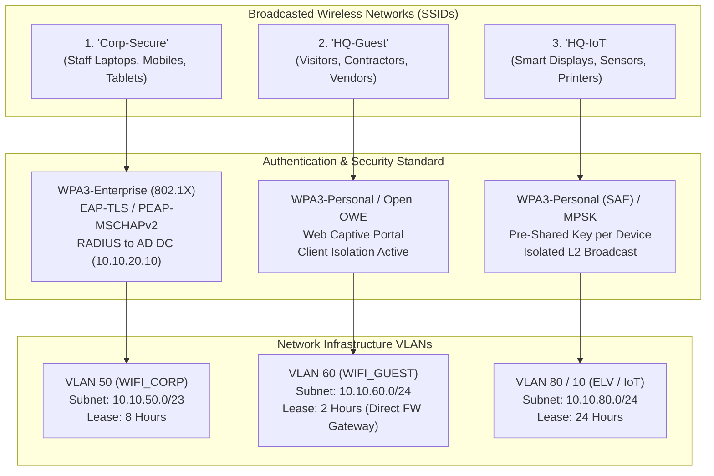

# Enterprise Wireless (Wi-Fi 6) Architecture Design

## 1. Overview & Wireless Strategy

This document details the engineering design for the high-density Wi-Fi 6 (IEEE 802.11ax) wireless infrastructure deployed across the 4-storey enterprise headquarters building (Ground + 3 floors).

The wireless network is engineered to deliver:
- Seamless, zero-drop voice roaming for mobile softphones and Wi-Fi calling.
- Robust security segmentation isolating corporate staff from visitors and IoT devices.
- High capacity supporting up to 400 concurrent wireless endpoints with deterministic throughput.
- Full compliance with IEEE 802.11k, 802.11v, and 802.11r roaming standards.

---

## 2. SSID Architecture & VLAN Segmentation

The wireless local area network broadcasts three distinct Service Set Identifiers (SSIDs), mapped directly to dedicated backend VLANs:



### SSID Technical Parameter Matrix:

| SSID Name | Target Audience | VLAN ID | Security Standard | Authentication Method | Fast Roaming (802.11r) | Bandwidth Limit per Client | Broadcast Bands |
|---|---|:---:|---|---|:---:|:---:|:---:|
| **`Corp-Secure`** | Corporate Employees | **50** | **WPA3-Enterprise** (AES-256) | 802.1X / RADIUS (Active Directory NPS) | **Enabled** (FT-802.1X) | Uncapped (Fair Share QoS) | 5 GHz Preferred (Band Select) |
| **`HQ-Guest`** | Visitors & Meeting Guests | **60** | **OWE / WPA3-Personal** | Web Captive Portal (Terms Acceptance) | Disabled | 10 Mbps Down / 2 Mbps Up | 2.4 GHz & 5 GHz |
| **`HQ-IoT`** | AV Displays & Smart Sensors | **80** | **WPA3-Personal (SAE)** | Multi-PSK (Device-specific passphrase) | Disabled | 5 Mbps Down / 5 Mbps Up | 2.4 GHz Only |

---

## 3. AP Count, Placement Logic & Capacity Sizing

### 3.1 Total AP Count & Floor Distribution
The building consists of four floors (Ground, Floor 1, Floor 2, Floor 3), each covering approximately $600\text{ m}^2$ to $800\text{ m}^2$ of enclosed office space.
- Sizing standard: **1 Access Point per $200\text{–}250\text{ m}^2$** or maximum **35–40 active concurrent users per AP radio**.
- **Total APs:** **12 Access Points** (3 APs per floor).

### 3.2 Floor-by-Floor AP Layout & Zones

```
┌────────────────────────────────────────────────────────────────────────┐
│ TYPICAL FLOOR LAYOUT (Floors 1 & 2 - 60 Staff + Meeting Rooms)        │
│                                                                        │
│   ┌──────────────────┐      ┌──────────────────┐     ┌─────────────┐   │
│   │  Meeting Room A  │      │  Open Office West │     │  Riser/IDF  │   │
│   │                  │      │                  │     │  Comms Rm   │   │
│   │    [AP-F1-01]    │      │    [AP-F1-02]    │     └─────────────┘   │
│   └──────────────────┘      └──────────────────┘                       │
│                                                                        │
│         ══════════════════ Central Corridor ══════════════════         │
│                                                                        │
│                             ┌──────────────────┐     ┌─────────────┐   │
│                             │  Open Office East │     │ Break Room  │   │
│                             │                  │     │ / Lounge    │   │
│                             │    [AP-F1-03]    │     │             │   │
│                             └──────────────────┘     └─────────────┘   │
└────────────────────────────────────────────────────────────────────────┘
```

- **AP 1 (West Wing / Meeting Suites):** Covers executive conference rooms and meeting booths with high device density during collaborative presentations.
- **AP 2 (Central Open Office):** Covers general open-plan cubicles and collaboration zones.
- **AP 3 (East Wing / Breakout):** Covers hot-desks, collaborative lounges, and pantry area.

### 3.3 Capacity & Bandwidth Calculations

1. **Client Concurrency Sizing:**
   - 200 total staff across the building.
   - Multi-device concurrency factor: $1.5$ wireless devices per user (laptop + mobile phone) = 300 active devices.
   - Visitor headroom (peak event): 60 visitor devices.
   - Total concurrent clients: $300 + 60 = 360$ clients.
   - **Average Clients per AP:** $\frac{360\text{ clients}}{12\text{ APs}} = \mathbf{30\text{ clients / AP}}$.
   - Wi-Fi 6 (802.11ax) enterprise APs support up to 200 associated stations per radio; 30 active stations per AP operates well below the saturation threshold (70% capacity buffer).

2. **Per-User Throughput Planning:**
   - Standard knowledge worker requirement: 5 Mbps continuous, 25 Mbps burst.
   - 5 GHz 802.11ax 2x2:2 client PHY rate (at 40 MHz channel width): ~574 Mbps.
   - Effective application throughput per AP: $\approx 350\text{ Mbps}$.
   - Available throughput per user during peak hour: $\frac{350\text{ Mbps}}{30\text{ clients}} \approx \mathbf{11.6\text{ Mbps continuous}}$, perfectly accommodating concurrent 1080p Zoom/Teams video conferencing and web browsing.

---

## 4. RF Channel & Transmit Power Plan

To avoid co-channel interference (CCI) and adjacent channel interference (ACI), radio channels and transmit powers are strictly planned:

### 4.1 2.4 GHz Band Plan (20 MHz Channel Width)
The 2.4 GHz spectrum offers only three non-overlapping channels: **1, 6, and 11**.
- Channel width: **20 MHz fixed** (40 MHz strictly disabled to avoid spectral overlap).
- Transmit power: **9 to 12 dBm (8 to 15 mW)**. Low power containment ensures cell boundaries match physical office walls and prevents sticky-client syndrome.
- Data rates: Legacy 1 Mbps, 2 Mbps, 5.5 Mbps, and 11 Mbps rates are **disabled**; mandatory basic rate is set to **12 Mbps** to reduce beacon overhead and force efficient airtime utilization.

### 4.2 5 GHz Band Plan (40 MHz Channel Width)
The 5 GHz spectrum provides abundant non-overlapping channels. We utilize 40 MHz channel bonding to balance high throughput with spectrum re-use:
- Available non-DFS channels: 36, 44, 149, 157.
- Available DFS channels (UNII-2 / UNII-2 Extended): 52, 60, 100, 108, 116, 132.
- Dynamic Frequency Selection (DFS) is enabled with automatic channel switching upon radar detection.
- Transmit power: **14 to 17 dBm (25 to 50 mW)**.

### 4.3 Floor-by-Floor Channel Allocation Scheme

| Floor | AP Hostname | Location Zone | 2.4 GHz Channel (20 MHz) | 5 GHz Channel (40 MHz) | 2.4 GHz Tx Power | 5 GHz Tx Power |
|---|---|---|:---:|:---:|:---:|:---:|
| **Ground** | `WAP-GF-01` | Reception & Conf A | **CH 1** | **CH 36 (36-40)** | 10 dBm | 15 dBm |
| | `WAP-GF-02` | Open Office GF | **CH 6** | **CH 52 (52-56) [DFS]** | 10 dBm | 15 dBm |
| | `WAP-GF-03` | South Office & Cafe | **CH 11**| **CH 100 (100-104) [DFS]** | 10 dBm | 15 dBm |
| **Floor 1** | `WAP-F1-01` | Meeting Suites F1 | **CH 6** | **CH 149 (149-153)** | 10 dBm | 15 dBm |
| | `WAP-F1-02` | Open Office West | **CH 11**| **CH 44 (44-48)** | 10 dBm | 15 dBm |
| | `WAP-F1-03` | Open Office East | **CH 1** | **CH 60 (60-64) [DFS]** | 10 dBm | 15 dBm |
| **Floor 2** | `WAP-F2-01` | Meeting Suites F2 | **CH 11**| **CH 108 (108-112) [DFS]** | 10 dBm | 15 dBm |
| | `WAP-F2-02` | Open Office West | **CH 1** | **CH 116 (116-120) [DFS]** | 10 dBm | 15 dBm |
| | `WAP-F2-03` | Open Office East | **CH 6** | **CH 36 (36-40)** | 10 dBm | 15 dBm |
| **Floor 3** | `WAP-F3-01` | Executive Boardroom | **CH 1** | **CH 132 (132-136) [DFS]** | 10 dBm | 15 dBm |
| | `WAP-F3-02` | Executive Suite West| **CH 6** | **CH 149 (149-153)** | 10 dBm | 15 dBm |
| | `WAP-F3-03` | Open Office East | **CH 11**| **CH 44 (44-48)** | 10 dBm | 15 dBm |

---

## 5. Wireless LAN Controller (WLC) Model & Roaming Standards

### 5.1 Architecture Model: On-Premises Redundant Appliance
- **Selected Platform:** Dual Cisco Catalyst 9800-L Wireless LAN Controllers deployed in an Active/Standby Stateful Switchover (SSO) High-Availability pair in the Ground Floor MDF Server Room.
- **Why On-Premises over Cloud?**
  1. **Low Latency & High Survivability:** Local CAPWAP termination keeps enterprise traffic within the LAN; in the event of an external WAN outage, internal voice, printing, and file access over Wi-Fi continues uninterrupted.
  2. **Sub-second SSO Failover:** If the active controller fails, the standby controller takes over with zero drop in client sessions or CAPWAP tunnels.
  3. **Seamless Integration:** Native telemetry integration with the Cisco Catalyst 9500 core switches and Active Directory RADIUS infrastructure.

### 5.2 Seamless Roaming Protocols (802.11k/v/r)
To enable zero-drop roaming for VoIP softphones (Microsoft Teams, Cisco Jabber, Zoom) as employees walk between floors:
1. **IEEE 802.11k (Radio Resource Management):** The AP creates and transmits an optimized neighbor report to clients. The client does not need to scan all 25 channels, reducing scan latency from 500 ms to under 20 ms.
2. **IEEE 802.11v (BSS Transition Management):** Allows the network infrastructure to advise clients to roam to a nearby lighter-loaded AP or from 2.4 GHz to 5 GHz (band steering).
3. **IEEE 802.11r (Fast BSS Transition / Fast Roaming):** Performs the four-way 802.1X handshake and encryption key derivation *before* the client roams to the new target AP. Roam handover time is cut to **less than 30 ms** (imperceptible to human speech, avoiding VoIP audio stutter).

---

## 6. Access Point Hardware & PoE Power Class

- **AP Model:** Cisco Catalyst 9120AXI (Indoor, Internal Omni-directional antennas, Wi-Fi 6 802.11ax 4x4:4 MU-MIMO).
- **Uplink Interface:** 1 $\times$ 100/1000/2.5G Multigigabit Ethernet (mGig RJ-45).
- **PoE Power Class:** **IEEE 802.3at PoE+ (Class 4)**.
  - Normal Power Consumption: **19.8 W** (Max 25.5 W).
  - Operating under standard 802.3af (15.4W) restricts the AP to reduced 2x2 radio mode and disables the USB port; hence, all switchports servicing APs are provisioned on **PoE+ 802.3at** switchports.

